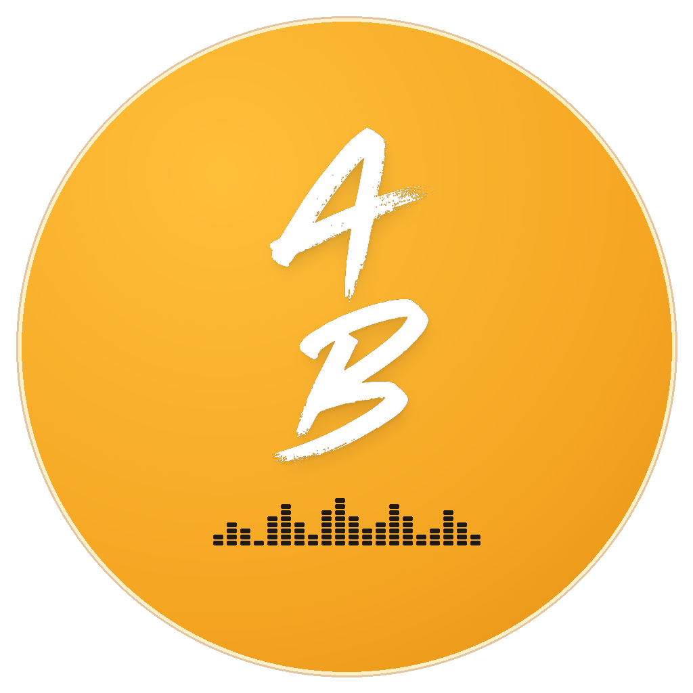
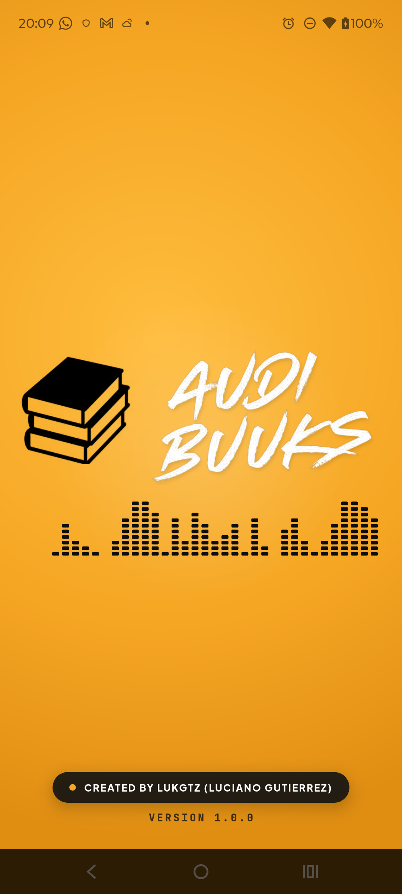
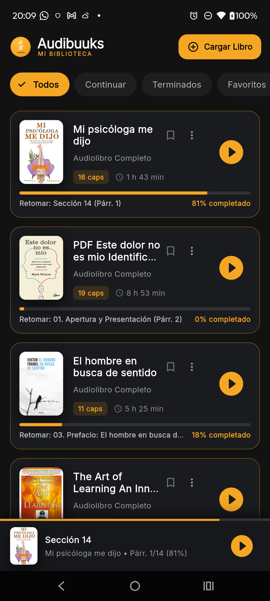
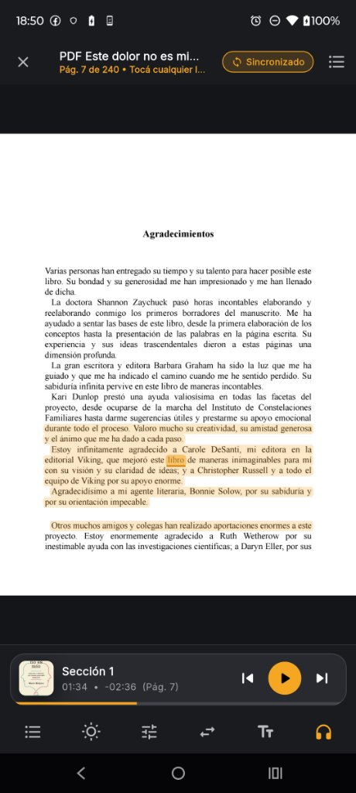

<p align="center">
  
</p>

<h1 align="center">Audibuuks (v1.0.0)</h1>

<p align="center">
  <b>El lector y reproductor inteligente de audiolibros definitivo para Android.</b><br/>
  Transformá tus libros en <b>PDF y EPUB</b> en audiolibros fluidos con <b>voces neuronales ultra-realistas</b>, notas sincronizadas por sección, música ambiental y reproducción continua en segundo plano.
</p>

<p align="center">
  <a href="https://github.com/lukgutierrez/audibuuks-app/releases"></a>
  
  
  
  
</p>

---

## 📱 Capturas de Pantalla

<p align="center">
  
  &nbsp;&nbsp;&nbsp;&nbsp;
  
  &nbsp;&nbsp;&nbsp;&nbsp;
  
</p>

---

## ✨ Características Principales

### 🎙️ Narración Neuronal de Última Generación
- **Edge-TTS Neural Cloud Engine:** Acceso a voces de alta fidelidad en español (Jorge, Gonzalo, Tomás, Elvira, Paloma, etc.) y múltiples idiomas.
- **Offline Fallback Engine:** Si no hay conexión a Internet, la app conmuta automáticamente al motor TTS local del dispositivo sin interrumpir la lectura.
- **Traducción Inteligente:** Detección de idioma y traducción instantánea de libros en inglés a español.

### 🎧 Reproducción Profesional en Segundo Plano
- **Android MediaSession Service:** Continuidad de audio con la pantalla apagada, controles interactivos en la cortina de notificaciones y en la pantalla de bloqueo.
- **Sonidos Ambientales & Binaurales:** Mezclador integrado de lluvia, olas, bosque, cafetería y ondas Lo-Fi sintetizadas nativamente en WAV.
- **Sleep Timer Inteligente:** Apagado programado por minutos o al finalizar el capítulo actual con atenuación suave de volumen (*fade-out*).

### 📖 Ingesta Avanzada de Documentos (PDF & EPUB)
- **Motor Tipográfico de Alta Precisión:** Procesamiento de PDF con modo `layoutText: true` que preserva saltos de línea, evita palabras pegadas y neutraliza artefactos de kerning.
- **Importación Cloud Directa:** Descarga libros pegando directamente un enlace de compartir de **Google Drive** o cualquier URL web de PDF/EPUB.
- **Subrayado y Seguimiento en Vivo:** Resaltado de párrafo y oración sincronizado palabra por palabra con la voz de narración.
- **Notas por Sección estilo Google Keep:** Bloc de notas integrado por cada capítulo con autoguardado instantáneo (<0.2 ms), paleta de colores y fijación.

---

## 🏛️ Arquitectura de Software e Ingeniería

Audibuuks fue construido siguiendo los principios de **Clean Architecture** y separación estricta de responsabilidades para garantizar rendimiento en tiempo real, consumo mínimo de batería y cero congelamientos en la UI (`0 ANRs`):

```
lib/
├── core/
│   ├── theme/            # Paleta de diseño (Dark Slate #0B0E14 & Amber #F5A623)
│   └── utils/            # Normalizadores tipográficos (TextSanitizer)
├── domain/
│   └── models/           # Entidades puras (BookItem, ChapterItem, AmbientTrackInfo)
├── data/
│   ├── repositories/     # LibraryRepository (Persistencia híbrida RAM + SharedPreferences)
│   └── services/         # Servicios de bajo nivel:
│       ├── audio_player_service.dart          # Orquestador MediaSession de Android
│       ├── tts_synthesis_service.dart         # Cliente WebSocket Edge-TTS
│       ├── pdf_extractor_service.dart         # Extractor Syncfusion en Background Isolates
│       └── cloud_book_downloader_service.dart # Descargador de Google Drive con streaming
└── ui/
    ├── features/
    │   ├── splash/       # Splash screen animada a 60 FPS con CustomPainter
    │   ├── library/      # Grid reactivo, filtros (Continuar, Terminados, Favoritos)
    │   ├── player/       # Reproductor modular desacoplado (5 sheets independientes)
    │   └── reader/       # Visor tipográfico interactivo con subrayado
    └── shared/           # Widgets reutilizables (Carátulas dinámicas, visualizadores)
```

> 📄 Para una explicación técnica detallada con diagramas Mermaid de secuencias, concurrencia y persistencia, consultá el archivo [ARQUITECTURA_SOFTWARE_AUDIBUUKS.md](ARQUITECTURA_SOFTWARE_AUDIBUUKS.md).

---

## 📥 Descarga e Instalación

Podés descargar el APK directamente desde la sección de **[Releases](https://github.com/lukgutierrez/audibuuks-app/releases)**:

1. Descargá **`Audibuuks_v1.0.0_arm64-v8a.apk`** (versión recomendada, sólo **21 MB**).
2. Abrí el archivo en tu celular Android.
3. Si el sistema lo solicita, autorizá *"Instalar aplicaciones de fuentes desconocidas"*.
4. ¡Listo! Ya podés disfrutar de tu biblioteca en cualquier lugar.

---

## 🛠️ Tecnologías Utilizadas

- **Framework:** [Flutter](https://flutter.dev) (Dart 3.x)
- **Audio Engine:** `just_audio` + `just_audio_background` + `audio_service`
- **Motor PDF:** `syncfusion_flutter_pdf` ejecutado en hilos secundarios (*Isolates*)
- **Motor TTS:** `edge_tts` (WebSockets) + `flutter_tts` (Local Fallback)
- **Tipografía:** [Google Fonts](https://fonts.google.com) (Plus Jakarta Sans & JetBrains Mono)
- **Traducción:** `translator` (Google Translate Engine)

---

## 👨‍💻 Autor

**Luciano Gutierrez (Lukgtz)**  
- GitHub: [@lukgutierrez](https://github.com/lukgutierrez)  
- Proyecto: **Audibuuks Mobile**  
- Versión: **1.0.0 (Build 2011)**  
